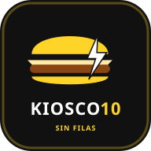

# 🍔 KIOSCO10 — Tu recreo, sin filas

> Aplicación web progresiva (PWA) moderna, full stack y responsive, diseñada para eliminar las filas en los recreos escolares mediante pedidos anticipados y retiro rápido en buffet.



---

## 📋 Tabla de Contenidos

1. [Problema que Resuelve](#-problema-que-resuelve)
2. [Identidad Visual](#-identidad-visual)
3. [Características Principales](#-características-principales)
4. [Estructura del Proyecto](#-estructura-del-proyecto)
5. [Tecnologías Utilizadas](#-tecnologías-utilizadas)
6. [Instrucciones de Ejecución Local](#-instrucciones-de-ejecución-local)
7. [Guía de Conexión con Supabase](#-guía-de-conexión-con-supabase)
8. [Seguridad y Políticas RLS](#-seguridad-y-políticas-rls)
9. [Instalación como PWA (Móviles y PC)](#-instalación-como-pwa)
10. [Publicación en Vercel](#-publicación-en-vercel)
11. [Modo Demostración para Muestra Escolar](#-modo-demostración-para-muestra-escolar)

---

## 🎯 Problema que Resuelve

En las instituciones educativas, los recreos duran entre 10 y 15 minutos. Durante ese breve lapso se generan filas masivas en el kiosco o buffet, provocando que muchos alumnos no lleguen a comprar su comida o deban ingerirla a las apuradas.

**Kiosco10** resuelve este problema:
- Alumnos y profesores eligen sus productos y envían su pedido **antes del recreo**.
- Seleccionan en qué recreo van a retirar (**1° Recreo**, **2° Recreo**, **Almuerzo** o **Tarde**).
- El kiosquero recibe los pedidos agrupados y organizados en tiempo real.
- El estudiante recibe un aviso en vivo: **"¡Listo para retirar!"** y se acerca directamente a la **fila rápida** mostrando su número de pedido (`#K10-XXXX`).

---

## 🎨 Identidad Visual

- **Nombre:** Kiosco10
- **Eslogan:** *"Tu recreo, sin filas"*
- **Colores Principales:**
  - Negro Profundo: `#111111`
  - Amarillo Kiosco10: `#FFD429` (Energía, rapidez, alta visibilidad)
  - Blanco: `#FFFFFF`
  - Gris Oscuro / Superficies: `#181818`, `#202020`, `#2b2b2b`
- **Tipografía:** Plus Jakarta Sans / Inter / Sans-serif moderna.
- **Diseño:** Mobile-first, adaptable a celulares, tablets y computadoras de escritorio.

---

## ✨ Características Principales

### 🎒 Para Alumnos y Profesores
- **Catálogo Organizado:** Sándwiches, Comidas calientes, Dulces y Bebidas con fotografías de alta definición, descripción y precios actualizados en pesos argentinos ($ ARS).
- **Buscador en tiempo real:** Filtrado instantáneo por nombre o ingrediente.
- **Filtros por Categoría:** Botones táctiles horizontales con iconos temáticos.
- **Carrito Interactivo:** Ajuste de cantidades (+/-), cálculo automático de subtotales y total, selector de recreo de retiro y notas especiales (ej: *"sin mayonesa"*).
- **Código Único de Retiro:** Generación de identificador inviolable (`#K10-XXXX`).
- **Seguimiento en Vivo en 4 Estados:**
  1. ⏳ **Pendiente:** Pedido recibido en el kiosco.
  2. 👨‍🍳 **En preparación:** El buffet está armando el paquete.
  3. 🔔 **Listo para retirar:** Alerta sonora y visual para acercarse a la fila rápida.
  4. ✅ **Entregado:** Pedido despachado y cobrado.
- **Historial del Alumno:** Consulta permanente de pedidos anteriores con fecha y montos.

### ⚡ Para el Kiosquero (Panel de Administración)
- **Monitoreo en Tiempo Real:** Actualizaciones instantáneas vía Supabase Realtime (y canal local entre pestañas) sin necesidad de recargar la página.
- **Alerta Sonora (Web Audio API):** Doble campana escolar configurable cada vez que ingresa un pedido nuevo.
- **Métricas del Día:** Total de pedidos, pedidos pendientes, listos para retirar y recaudación acumulada ($).
- **Gestión de Estados:** Botones directos para avanzar cada pedido (*Preparar* ➔ *Marcar Listo* ➔ *Entregar*).
- **Editor de Precios y Stock:** Modal para cambiar precios de cualquier artículo o alternar estado *Disponible* / *Agotado* al instante.

---

## 📁 Estructura del Proyecto

```text
KIOSCO10/
├── index.html                   # Página principal HTML5 semántica y accesible
├── package.json                 # Dependencias y scripts npm
├── supabase-schema.sql          # Script SQL completo: tablas, RLS, Realtime y RPC seguro
├── vercel.json                  # Configuración de despliegue para Vercel
├── .env.example                 # Plantilla de variables de entorno seguras
├── README.md                    # Documentación técnica completa
├── GUIA_JURADO.md               # Guía paso a paso para la defensa ante el jurado escolar
├── public/
│   ├── favicon.svg              # Isotipo oficial Kiosco10
│   ├── manifest.json            # Manifiesto de la Progressive Web App (PWA)
│   ├── service-worker.js        # Service Worker para caché y soporte offline
│   └── icons/
│       ├── icon-192.svg         # Icono para dispositivos móviles (192px)
│       └── icon-512.svg         # Icono de alta resolución y splash screen (512px)
└── src/
    ├── main.js                  # Punto de entrada, enrutador hash y orquestador
    ├── style.css                # Hoja de estilos raíz
    ├── store.js                 # Gestor reactivo de estado global
    ├── assets/
    │   └── logo.svg             # Logotipo vectorial Kiosco10
    ├── data/
    │   └── defaultProducts.js   # Catálogo oficial escolar y estados de pedidos
    ├── services/
    │   ├── supabaseClient.js    # Cliente Supabase + fallback a canal de difusión local
    │   ├── authService.js       # Autenticación Supabase Auth + perfiles
    │   ├── productsService.js   # Catálogo y actualización de precios/stock
    │   ├── ordersService.js     # Creación segura de pedidos + Realtime
    │   ├── audioService.js      # Sintetizador nativo Web Audio API para campana
    │   └── demoDataService.js   # Usuarios y pedidos de prueba para la muestra escolar
    ├── components/
    │   ├── Navbar.js            # Cabecera responsive y selector rápido de roles
    │   ├── HeroBanner.js        # Portada con eslogan y propuesta de valor
    │   ├── CategoryBar.js       # Barra táctil de filtros de categorías
    │   ├── ProductCard.js       # Tarjeta de producto con foto y botón de compra
    │   ├── MenuView.js          # Vista del menú y catálogo interactivo
    │   ├── CartDrawer.js        # Carrito lateral deslizable y checkout
    │   ├── OrderSuccessModal.js # Modal festivo con confetti y número de retiro
    │   ├── StudentHistory.js    # Historial y seguimiento en vivo del alumno
    │   ├── AdminDashboard.js    # Tablero en tiempo real del kiosquero
    │   ├── AuthModal.js         # Modal de inicio de sesión y registro escolar
    │   ├── ConfigModal.js       # Modal en la app para conectar Supabase
    │   ├── OfflineBanner.js     # Detección de pérdida de conectividad
    │   └── InstallPrompt.js     # Botón para instalar PWA en el celular
    └── styles/
        ├── variables.css        # Colores institucionales y tipografía
        ├── base.css             # Resets, botones, inputs y toasts
        ├── components.css       # Estilos de tarjetas, navbar, hero y modales
        ├── admin.css            # Estilos del panel del buffet y métricas
        └── responsive.css       # Adaptaciones celulares, tablets y desktop
```

---

## 🛠️ Tecnologías Utilizadas

- **Frontend:** HTML5 Semántico, CSS3 moderno (Variables CSS, Flexbox, CSS Grid), JavaScript ES Modules (Vanilla JS de alto rendimiento).
- **Bundler y Dev Server:** Vite 5 (arranque instantáneo y compilación optimizada).
- **Backend as a Service:** Supabase:
  - **Supabase Database:** PostgreSQL relacional.
  - **Supabase Auth:** Registro seguro con encriptación y perfiles extendidos.
  - **Supabase Realtime:** Transmisión WebSockets en milisegundos.
  - **PostgreSQL RPC:** Procedimiento `create_secure_order` con `SECURITY DEFINER` para cálculo y validación de precios en servidor.
- **PWA:** Service Worker con estrategia de caché estática y Web App Manifest para instalación nativa.
- **Audio:** Web Audio API (efectos de campana sin dependencias externas).
- **Efectos:** Canvas Confetti para celebración de pedidos confirmados.
- **Hosting:** Diseñado para Vercel con reglas de rewrite SPA y compresión gzip.

---

## 🚀 Instrucciones de Ejecución Local

### Prerrequisitos
- Node.js versión 18 o superior instalado en el equipo.

### Pasos

1. **Abrir la terminal en la carpeta del proyecto:**
   ```bash
   cd KIOSCO10
   ```

2. **Instalar dependencias:**
   ```bash
   npm install
   ```

3. **Iniciar el servidor de desarrollo:**
   ```bash
   npm run dev
   ```

4. **Abrir en el navegador:**
   - Hacé clic en la URL local que muestra la terminal (usualmente `http://localhost:5173/`).
   - La aplicación abrirá automáticamente en **Modo Demostración** con datos completos listos para probar sin necesidad de configurar nada previamente.

5. **Compilar para producción (opcional):**
   ```bash
   npm run build
   npm run preview
   ```

---

## 🗄️ Guía de Conexión con Supabase

Si deseás conectar la aplicación a tu propia base de datos en la nube de Supabase:

### Paso 1: Crear proyecto en Supabase
1. Ingresá a [https://supabase.com](https://supabase.com) y registrate gratis.
2. Hacé clic en **"New Project"**.
3. Elegí un nombre (ej: `kiosco10-escolar`), definí una contraseña segura de base de datos y seleccioná la región más cercana (ej: *South America - São Paulo*).

### Paso 2: Ejecutar el script SQL
1. En el menú lateral izquierdo de Supabase, hacé clic en **"SQL Editor"**.
2. Hacé clic en **"New query"**.
3. Abrí el archivo `supabase-schema.sql` de este proyecto, copiá todo su contenido y pegalo en el editor de Supabase.
4. Presioná el botón verde **"Run"**.
   - Se crearán las tablas: `profiles`, `products`, `orders`, `order_items`.
   - Se configurarán las políticas de seguridad (RLS).
   - Se creará la función antifraude `create_secure_order`.
   - Se habilitará la suscripción Realtime.
   - Se poblarán los 17 productos iniciales con fotos y precios.

### Paso 3: Obtener las credenciales del proyecto
1. En Supabase, andá a **Project Settings** (ícono de engranaje) ➔ **API**.
2. Copiá:
   - **Project URL** (ej: `https://abcdefghijklm.supabase.co`)
   - **Project API Key** ➔ buscá la que dice `anon` / `public`. *(NUNCA uses la service_role)*.

### Paso 4: Conectar en Kiosco10
Tenés dos formas de conectarlo:

- **Opción A (Desde la interfaz de la aplicación - Más fácil):**
  1. Abrí Kiosco10 en tu navegador.
  2. Hacé clic en el ícono de engranaje **⚙️** en la esquina superior derecha del Navbar.
  3. Pegá la URL y la Anon Key.
  4. Hacé clic en **"Guardar y Conectar"**. La app se recargará y el ícono pasará a color verde **🟢**.

- **Opción B (Mediante archivo .env):**
  1. Creá un archivo `.env` en la raíz del proyecto (copiando `.env.example`).
  2. Completá las variables:
     ```env
     VITE_SUPABASE_URL=https://tu-proyecto.supabase.co
     VITE_SUPABASE_ANON_KEY=tu-clave-anonima-publica
     ```
  3. Reiniciá el servidor Vite (`npm run dev`).

---

## 🔒 Seguridad y Políticas RLS

Kiosco10 implementa estrictas normas de seguridad web:

1. **Protección Antifraude en Precios (Server-Side Validation):**
   - El cliente web **nunca** define el precio final que se guarda en la base de datos.
   - El pedido se procesa mediante la función PostgreSQL `create_secure_order(...)` con `SECURITY DEFINER`.
   - Esta función consulta directamente la tabla oficial `products`, verifica que el producto esté disponible (`available = true`), toma el precio oficial en el servidor y calcula los subtotales y el total.
   - Si un usuario malintencionado intenta alterar los importes desde las herramientas de desarrollador, el servidor los ignora por completo.

2. **Row Level Security (RLS) en todas las tablas:**
   - `profiles`: Cada usuario solo puede ver y editar su propio perfil; el kiosquero con rol `admin` puede consultar los perfiles escolares.
   - `products`: Lectura pública para que cualquier alumno pueda consultar el menú; inserción, edición de precios y borrado restringido exclusivamente a administradores (`public.is_admin()`).
   - `orders`: Los alumnos solo tienen permiso SELECT para sus propios pedidos (`auth.uid() = user_id`); el kiosquero tiene permiso para ver y actualizar todos los pedidos.
   - `order_items`: Visibles únicamente para el dueño del pedido o el administrador.

3. **Clave secreta resguardada:**
   - La clave `service_role` de Supabase **nunca** se incluye en el código frontend.

---

## 📱 Instalación como PWA

La aplicación cumple con el estándar de **Progressive Web App**:

- **En Celulares Android (Chrome / Edge):**
  Al ingresar a la app, aparecerá un banner automático: *"Instalar Kiosco10 en tu celular"*. Al presionar **"Instalar App"**, se agregará a la pantalla de inicio con su ícono oficial y funcionará a pantalla completa como una app nativa.
- **En iPhone / iPad (Safari):**
  Tocá el botón **Compartir** (icono de cuadrado con flecha hacia arriba) y seleccioná **"Agregar a pantalla de inicio"**.
- **En Computadoras (Chrome / Edge):**
  Aparecerá el ícono de instalación en la barra de direcciones del navegador.
- **Modo Offline:**
  El Service Worker guarda en caché los recursos estáticos (HTML, CSS, JS, iconos). Si el alumno se queda sin datos, podrá abrir la app y ver los productos. Si intenta hacer un pedido sin conexión, la app le informará de manera clara que se requiere conexión para confirmarlo en el kiosco.

---

## 🌐 Publicación en Vercel

El proyecto incluye el archivo `vercel.json` configurado para despliegue en un clic.

### Pasos para publicar:

1. **Subir el código a GitHub:**
   ```bash
   git init
   git add .
   git commit -m "Initial commit - Kiosco10"
   git branch -M main
   git remote add origin https://github.com/tu-usuario/kiosco10.git
   git push -u origin main
   ```

2. **Importar en Vercel:**
   1. Ingresá a [https://vercel.com](https://vercel.com) e iniciá sesión con GitHub.
   2. Hacé clic en **"Add New..." ➔ "Project"**.
   3. Seleccioná el repositorio `kiosco10`.
   4. Vercel detectará automáticamente que es un proyecto **Vite**.
   5. *(Opcional)* En la sección **Environment Variables**, agregá:
      - `VITE_SUPABASE_URL`
      - `VITE_SUPABASE_ANON_KEY`
   6. Hacé clic en **"Deploy"**.

¡Listo! En menos de 1 minuto tendrás una URL pública HTTPS (ej: `https://kiosco10.vercel.app`) lista para presentar en la muestra escolar.

---

## 🎪 Modo Demostración para Muestra Escolar

Para facilitar la evaluación frente al jurado y profesores sin depender de internet o configuraciones externas:

1. Al abrir la app, hacé clic en la pastilla de usuario en la cabecera (dice **"🎒 Santiago Benítez"**).
2. Podés cambiar instantáneamente entre:
   - **🎒 Santiago Benítez (Alumno):** Realiza pedidos, elige recreos y visualiza su historial con estados en vivo.
   - **👨‍🏫 Prof. Marcelo Morales (Docente):** Demuestra que el personal educativo también puede utilizar la plataforma.
   - **⚡ Don Roberto (Kiosquero Admin):** Acceso inmediato al **Panel Kiosquero**, recepción de pedidos en tiempo real con sonido de campana, botones para cambiar estados y editor de precios/stock.
3. **Simulación en Tiempo Real entre 2 pestañas:**
   - Abrí dos pestañas en el navegador: una como Alumno y otra como Kiosquero.
   - Al confirmar un pedido en la pestaña de Alumno, la pestaña del Kiosquero **sonará la campana y mostrará el pedido inmediatamente** sin recargar.
   - Cuando el Kiosquero presione **"Marcar LISTO"**, la pestaña del Alumno mostrará una notificación verde de confirmación para retirar por la fila rápida.

---

## 📄 Licencia y Créditos

Proyecto desarrollado para instituciones educativas.
**Kiosco10 — Tu recreo, sin filas.**
Organización estudiantil y buffet escolar.

